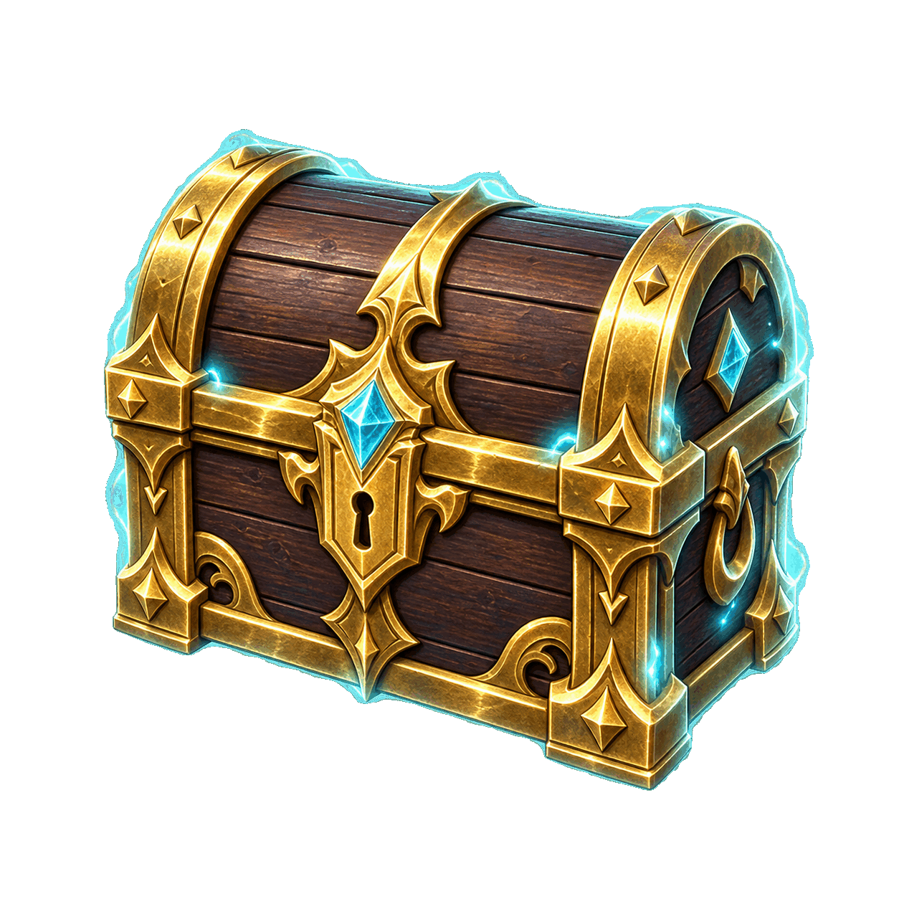
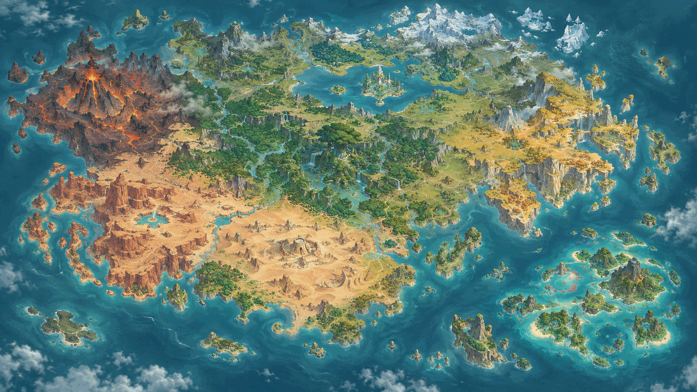

<div align="center">


# Hidden Chest Atlas

### Real Teyvat locations. Your next discovery.

Explore Genshin Impact chest and puzzle locations using HoYoLAB map data,<br/>navigate the terrain, and keep a personal checklist of your finds.

[](https://hidden-chest-atlas.shaqib-dev.chatgpt.site)


[Features](#features) · [API integration](#api-integration) · [Development](#development) · [Roadmap](#roadmap)
</div>

## Features

| Explore | Track | Navigate |
| --- | --- | --- |
| Real chest and puzzle coordinates from HoYoLAB | Mark finds and undo mistakes | Drag to pan, zoom buttons and keyboard controls |
| Region and discovery category filters | Hide completed locations | Clustered markers when zoomed out |
| Search by region, category name or marker ID | Export a JSON progress backup | Fit the filtered locations into view |
| Surface terrain tiles from HoYoverse | Browser-local storage with failure feedback | Open an area in HoYoLAB for community guides |
| HoYoLAB-style icon shelf with category art and counts | Category-specific marker icons | Selected layers update the map and location list together |

The nine fictional prototype locations have been removed from the active explorer. The old sample checklist is left untouched in browser storage and is **not** migrated onto real HoYoLAB marker IDs.

> **A map checklist, not account synchronization.** This app does not read your game account, automatically detect opened chests, or report your in-game exploration percentage. The percentage shown is completion of the current filtered checklist. Not every available category is compass-undetectable.

## API integration

The app uses the public endpoints behind the [HoYoLAB Teyvat Interactive Map](https://act.hoyolab.com/ys/app/interactive-map/index.html?lang=en-us#/map/2). No account cookies or API keys are requested.

| Upstream endpoint | Purpose |
| --- | --- |
| `/v3/map/info?map_id=2` | Current terrain version, size, origin and zoom levels |
| `/v1/map/label/tree?map_id=2` | Chest and puzzle category names |
| `/v1/map/get_area_pageLabel?map_id=2` | Teyvat region names and IDs |
| `/v1/map/point/list?map_id=2` | Location IDs, coordinates, categories and floor indicators |

The checked-in `data/exploration.json` snapshot contains the 15 layers used by the reference URL (`694,17,44,45,46,269,18,70,64,71,77,79,69,798,836`), their official icon artwork, the current terrain metadata, eight regions and 6,012 locations. The app exposes `/api/exploration` for metadata and `/api/exploration?category=69` for a category's locations. Keeping this compact snapshot in the repository prevents a slow or rate-limited upstream response from leaving the map blank in a preview or deployment.

The original upstream `label_ids` parameter returned empty success responses during verification, so the snapshot is normalized once and the route filters it locally by category. Metadata is cached for an hour, locations for ten minutes, and responses carry shorter HTTP cache lifetimes. Caches are per running server instance.

Terrain is loaded on demand from `act-webstatic.hoyoverse.com`, using the current version returned by the API. Marker projection adds the API's map origin to each source coordinate, preserving the relationship between terrain and locations.

### Verification and limitations

Live checks on **October 28, 2026** returned 15 selected icon categories, 8 Teyvat regions, 103 buried-chest locations and 1,448 common-chest locations. These are observed API counts, not a guarantee of game completeness. Terrain image delivery and category-specific icon rendering were also verified in the browser.

- The checked-in snapshot can age as HoYoLAB adds locations or changes category art; refresh it from the documented endpoints when a current dataset is needed.
- This version renders the Teyvat surface map. Separate underground floor imagery and other map IDs are not implemented; floor indicators and HoYoLAB links help identify those cases.
- Community instructions remain on HoYoLAB. The app does not invent chest names, rewards or puzzle walkthroughs.
- Progress belongs to the current browser. JSON export is available; import and account synchronization are not yet implemented.
- No fictional sample locations are used by the active explorer; every rendered point comes from the pinned HoYoLAB snapshot.

## Development

Requires Node.js 22.13+ and pnpm 11+.

```bash
git clone https://github.com/Skeeb32/Genshin-Interactive-Hidden-Chest-Map.git
cd Genshin-Interactive-Hidden-Chest-Map
pnpm install
pnpm dev
```

```bash
pnpm exec tsc --noEmit
node scripts/test-exploration.mjs
pnpm build
```

The focused checks cover terrain metadata, coordinate alignment, duplicate IDs, category isolation and snapshot counts. Browser visual QA verified the icon shelf, category switching, official terrain tiles and category-specific map markers.

| File | Responsibility |
| --- | --- |
| `app/page.tsx` | Filters, loading/retry states, location details and progress |
| `app/api/exploration/route.ts` | Snapshot-backed API adapter, validation and caches |
| `components/terrain-map.tsx` | Terrain tiles, coordinates, clustering and navigation |
| `lib/exploration.ts` | Shared models, projection and progress parsing |
| `scripts/test-exploration.mjs` | Focused API and data safety checks |

Built with React, TypeScript, Vinext, Vite and Lucide. Hosted as a Cloudflare-compatible Worker.

## Roadmap

1. Add underground floor overlays and additional map IDs.
2. Add progress import with source/version validation.
3. Improve guide integration and location sharing.
4. Add browser interaction coverage and current screenshots.
5. Consider optional account-level statistics without implying per-chest synchronization.

<details>
<summary>Original concept artwork</summary>



This is the original prototype illustration, not a screenshot of the current API-backed map.
</details>

## Contributing and credits

Report issues with a marker ID, category, region, expected behavior and reproduction steps. Keep source coordinates intact and avoid presenting estimates as verified discoveries.

Map imagery and source data are provided by HoYoverse through HoYoLAB; their rights remain with their owners. The treasure marker and original concept artwork are project assets. This is an independent fan project, not affiliated with or endorsed by HoYoverse.

<div align="center">

**Built by Shaqib Habib** · [Explore Hidden Chest Atlas](https://hidden-chest-atlas.shaqib-dev.chatgpt.site)

</div>
